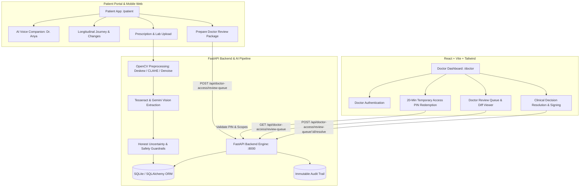

# HealthContinuum AI 🏥🤖

> **"Understand what changed. Know why. Close the gap."**  
> *A unified, patient-centered healthcare continuity and clinical intelligence platform bridging patient records, advanced handwritten medical document OCR, and doctor verification workflows.*

---

## 🌟 Executive Summary

Patients frequently navigate multiple hospitals, specialists, and diagnostic labs, accumulating fragmented medical records, unclear handwritten prescriptions, and conflicting instructions. When medication doses change or reports go missing, patients often do not understand *why*, leading to poor adherence, dangerous drug interactions, and preventable complications.

**HealthContinuum AI** solves this critical healthcare challenge by:
1. **Unifying Medical Records:** Seamlessly ingesting prescriptions, doctor consultation notes, and laboratory reports across different visits and hospitals into a coherent longitudinal timeline.
2. **Advanced Medical Document & Handwriting OCR:** Combining computer vision image preprocessing (CLAHE contrast normalization, deskewing, denoising) with medical shorthand normalization to accurately decipher prescriptions while enforcing **honest uncertainty detection** (flagging illegible or ambiguous instructions rather than guessing).
3. **End-to-End "Review for Doctor" Workflow:** Allowing patients to select uncertain fields, conflicts, or questions, bundle them into a secure review package, and generate a **20-minute temporary PIN** for their doctor.
4. **Clinical Doctor Dashboard:** Empowering physicians to review patient continuity comparisons, inspect source document crops, resolve pending prescription uncertainties with authoritative notes, and maintain an immutable clinical audit trail.
5. **Interactive AI Health Companion (Dr. Anya):** Providing multilingual (English & Telugu) patient assistance with voice recognition, speech synthesis, and source-grounded answers.

---

## 🏗️ System Architecture



---

## 📦 Key Components

### 1. Unified Landing Portal (`/`)
- Accessible at `http://localhost:8000/`
- Direct access to the **Patient Application**, **Doctor Dashboard**, and **Interactive OpenAPI Documentation**.

### 2. Patient-Facing Application (`/patient`)
- **Longitudinal Health Journey:** Chronological feed tracking doctor visits, laboratory investigations, and medication changes.
- **Change Explanations:** Explains *why* medications changed (e.g., Metformin reduced from 500 mg twice daily to once daily due to improved renal function eGFR 68 → 82 mL/min).
- **Multilingual Support:** Instant language toggle between English and Telugu (`తెలుగు`).
- **Interactive Voice Health Companion (Dr. Anya):** Web Speech API voice synthesis and speech-to-text.
- **Prepare Doctor Review Feature:** Gathers unverified handwritten items and conflicts into an organized package and issues a 6-digit access code for clinical sign-off.

### 3. Doctor Clinical Dashboard (`/doctor`)
- Built with **React 18**, **TypeScript**, **Tailwind CSS**, and **Lucide Icons**.
- **Secure PIN Redemption:** Doctors enter the patient's 6-digit PIN to unlock temporary, scoped access.
- **Continuity Review:** Visual diffs comparing prior vs. current lab trends and prescriptions.
- **Doctor Review Queue:** Instant list of patient-submitted uncertain records with image previews and single-click resolution.
- **Clinical Decision Support & Notes:** Create, amend, and sign clinical notes.

### 4. Backend Engine & API (`/api`)
- Built with **FastAPI**, **SQLAlchemy (Async)**, and **Pydantic v2**.
- **Advanced Preprocessing Pipeline (`extraction_service.py`):**
  - Grayscale conversion and Otsu/adaptive thresholding
  - Minimum area bounding box deskewing
  - CLAHE (Contrast Limited Adaptive Histogram Equalization)
  - Medical Latin and Indian prescription shorthand abbreviation resolution (`OD`, `BD`, `TDS`, `QDS`, `HS`, `PC`, `AC`, `SOS`, `1-0-1`, `1-0-0`)
  - Safety rule: If handwriting is ambiguous, prompts: *"Unable to read this instruction reliably. Please confirm with your prescribing doctor or pharmacist before relying on it."*

---

## 🚀 Quick Start Guide

### Prerequisites
- **Python 3.10+** (Tested on Python 3.11 / 3.12 / 3.14)
- **Node.js 18+** & npm (for building the Doctor Dashboard)
- Tesseract OCR (Optional: system fallback extraction included)

---

### Method A: One-Click Launch (Windows)

Simply run the unified launcher script:
```cmd
start_all.bat
```
This automatically:
1. Seeds the authoritative database with demo patients and doctors.
2. Builds the Doctor Dashboard production bundle into `doctorsdashboard-main/dist`.
3. Starts the unified FastAPI backend on `http://localhost:8000`.

---

### Method B: Manual Setup

#### Step 1: Backend Setup
```bash
# Navigate to backend directory
cd maruthi/Health/backend

# Install Python dependencies
pip install -r requirements.txt

# Seed the database
python seed.py

# Start FastAPI server
python -m uvicorn app.main:app --host 0.0.0.0 --port 8000 --reload
```

#### Step 2: Doctor Dashboard Build
```bash
# Navigate to doctor dashboard directory
cd doctorsdashboard-main

# Install dependencies
npm install

# Build production assets for unified FastAPI serving
npm run build
```
*(Alternatively, run `npm run dev` in `doctorsdashboard-main` to run on Vite dev server at `http://localhost:5173`)*.

---

## 🔗 Port & URL Sitemap

| Service | URL | Description |
| :--- | :--- | :--- |
| **Unified Portal** | [http://localhost:8000/](http://localhost:8000/) | Central launcher and hub |
| **Patient Application** | [http://localhost:8000/patient](http://localhost:8000/patient) | Patient mobile/web app |
| **Doctor Dashboard** | [http://localhost:8000/doctor](http://localhost:8000/doctor) | Clinical doctor portal |
| **Swagger API Docs** | [http://localhost:8000/api/docs](http://localhost:8000/api/docs) | Interactive API specifications |
| **System Health Check** | [http://localhost:8000/api/health](http://localhost:8000/api/health) | Uptime and environment status |

---

## 🔑 Demo Credentials & Accounts

### Doctor Account
- **Email:** `ananya.sharma@continuumhealth.in`
- **Password:** `Doctor@123`
- **Name:** Dr. Ananya Sharma (MD, General Medicine)
- **Registration No:** MCI-2016-89412

### Patient Record
- **Patient ID:** `pat-ramesh-001`
- **Name:** Ramesh Kumar (Age: 42, B+)
- **UHID:** `HC-2024-00847`
- **Hospital:** City Care Hospital, Chennai
- **Key Condition:** Type 2 Diabetes Mellitus with improving renal function

---

## 📁 Repository Directory Structure

```text
├── start_all.bat                   # One-click launcher for the unified platform
├── README.md                       # Comprehensive project documentation
├── .gitignore                      # Git ignore rules for Python & Node
├── doctorsdashboard-main/          # Doctor Clinical Dashboard (React + TypeScript)
│   ├── package.json                # Frontend dependencies & scripts
│   ├── vite.config.ts              # Vite configuration
│   ├── dist/                       # Compiled production build served by FastAPI
│   └── src/
│       ├── components/             # AppShell, UI components, PinInput
│       ├── context/                # AuthContext & Session management
│       ├── pages/                  # Overview, ContinuityReview, Patients, Settings
│       ├── services/               # API service layer and fixtures
│       └── types/                  # TypeScript interface definitions
└── maruthi/
    ├── healthcontinuum.html        # Unified landing page
    └── Health/
        ├── index.html              # Patient App entrypoint
        ├── app.js                  # Patient App logic, companion & review workflows
        ├── styles.css              # Glassmorphic, modern healthcare styling
        ├── api.js                  # Frontend REST API client
        └── backend/
            ├── requirements.txt    # Python backend requirements
            ├── seed.py             # Database seed script
            ├── healthcontinuum.db  # SQLite database instance
            ├── uploads/            # Medical document upload repository
            └── app/
                ├── main.py         # FastAPI application entry & static file mounts
                ├── core/           # Security, JWT, configuration settings
                ├── database/       # Async SQLite connection & session maker
                ├── models/         # SQLAlchemy ORM models (Patient, Visit, ReviewQueue, etc.)
                ├── schemas/        # Pydantic validation schemas
                ├── services/       # Extraction, OCR, Document & Companion services
                └── api/routes/     # REST routers: auth, patients, documents, doctor_access, etc.
```

---

## 🛡️ Clinical Safety & Ethical AI Principles

1. **No Hallucinated Prescriptions:** The system strictly prohibits language models from guessing unreadable medicine names, doses, or frequencies. If confidence is below threshold or handwriting is ambiguous, the instruction is flagged as `UNCERTAIN` or `UNREADABLE`.
2. **Explicit Verification Notice:** All uncertain fields display clear disclaimers advising patients to confirm with their doctor or pharmacist before relying on extracted text.
3. **Audit Trail & Consent:** Doctor access requires an explicit temporary PIN generated by the patient. Every access grant, record view, and resolution is logged in an immutable audit table.
4. **Physician Authority:** AI provides decision support and comparison diffs; only licensed healthcare providers can make final clinical determinations.

---

## 📄 License
This project is developed for hackathon demonstration and clinical continuity research. All synthetic patient records comply with health privacy best practices.
